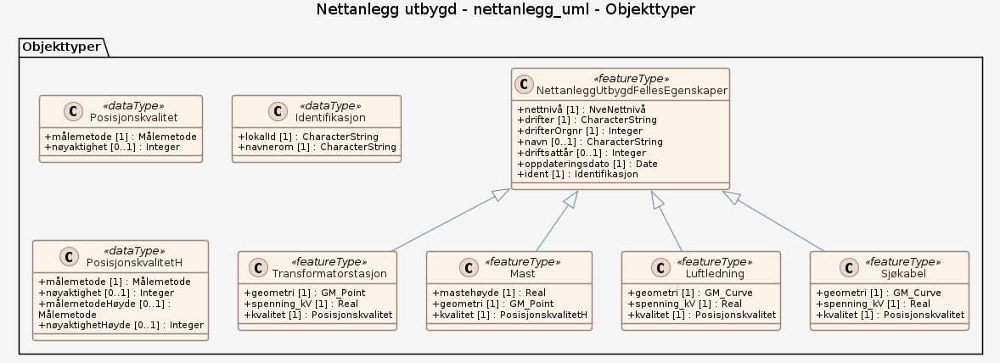

# Produktspesifikasjon: Nettanlegg utbygd

*Nettanlegg utbygd viser beliggenhet av luftledning, sjøkabler, transformatorstasjoner og master i transmisjons- og regionalnettet sammen med noe nøkkelinformasjon, som spenningsnivå, nettnivå, oppdateringsdato og drifter/anleggskonsesjonær.  Distribusjonsnett er ikke en del av datasettet. Jordkabler er heller ikke inkludert. 
Datasettet oppdateres av konsesjonærer i regional- og transmisjonsnettet. De er pålagt å oppdatere hver 6. måned dersom det har blitt gjort endringer nettet. De har mulighet til å oppdatere så ofte de ønsker.*

**Nøkkelord:** transformatorstasjoner, sjøkabler, master, transmisjonsnett, regionalnett, kraftlinjer, Energiressurser, beredskapsbase, Inspire, Norge digitalt, geodataloven, modellbaserteVegprosjekter, fellesDatakatalog, Energi, Linjer, Kabel, Luftlinje, Mast, Stasjoner, komponentkodeverdi, komponentkodesystem, typebetegnelse, tverrsnitt, lengdetype, sysbasID, linjehøyde, seilingshøyde, konstruksjon, mastehøyde, luftfartshindermerking, antallBrytere, drifter, kildeLokalID, drifterOrgnr, driftsattår, driftsmerking, eierOrgnr, kildeDato, kildeEndretDato, kildeOrgnr, nettnivå, nveOpprettetDato, spenning, antallGeneratorer, antallTrafoer, totalYtelseGeneratorer, totalYtelseTrafoer, Posisjonskvalitet2D, EL_Mast, EL_Luftlinje, EL_Hengekabel, EL_Sjøkabel, EL_Transformatorstasjon, linje, Norge

**Emnekategorier:** Ledningsinformasjon

**Geografisk utstrekning**:

- **Vest**: 2.0
- **Øst**: 33.0
- **Sør**: 57.0
- **Nord**: 72.0

**Geografisk område**:
Norges fastland

**Tidsmessig utstrekning**:

- **Tidsperiode**:
  - **Fra**: 2016-01-07
  - **Til**: 2026-09-01

## Om spesifikasjonen

> **Denne versjonen av produktspesifikasjonen:**  
> **Opprettet dato:** 2016-01-07 
> **Endret dato:** 2026-09-01 
> **Språk:** nor 
> **Kontaktinformasjon:** Norges vassdrags- og energidirektorat, [gisstotte@nve.no](mailto:gisstotte@nve.no)

## Om produktet Nettanlegg utbygd

> **Romlig representasjonstype:** Vektor 
> **Unik identifikator:** <https://data.geonorge.no/sosi/energi/nettanlegg> 
> **Kontaktinformasjon:** Norges vassdrags- og energidirektorat, [gisstotte@nve.no](mailto:gisstotte@nve.no)
>
> **Romlig oppløsning:**
>
> **Ekvivalent målestokk**: 50000
>
> **Begrensninger:**
>
> **Juridiske begrensninger**:
>
> - **Tilgangsbegrensninger**: Åpne data
> - **Bruksbegrensninger**: Lisens
> - **Lisens**: Norsk lisens for offentlige data (NLOD)
> - **Lisenslenke**: <http://data.norge.no/nlod/no/1.0>

### Formål

Innrapportering av data til NVE skal dekke NVEs eget behov for oversikt. NVE har ikke myndighet til å kreve data fra anleggskonsesjonærer utover det NVE selv har behov for i sitt arbeid.

### Bruksområde

Datasettets bruk i planarbeidet:
NVE har ikke god oversikt over hvordan datasettet benyttes i planarbeid. · Datasettet inneholder ikke informasjon om byggeforbudssoner eller stråling. Dette er informasjon som heller ikke kan utledes direkte av dataene. Det er eventuelt anleggskonsesjonær som har informasjon og data om dette. 
Kommunene bør alltid oppfordres til å kontakte dataeier for oppdatert informasjon. Dette er nettanleggskonsesjonærer, ikke NVE.

Datasettet kan benyttes ved ROS-analyser og ved utarbeidelse av hensynssoner knyttet til elektriske anlegg. NVE fraskriver seg ansvar for skade som skyldes feil i data og feil bruk av data.

## Omfang

### Hele datasettet

**Nivå**: dataset

**Nivåbeskrivelse**: Gjelder hele datasettet. Hvis omfang ikke er oppgitt under en overskrift, gjelder teksten for hele datasettet og alle leveranser

### nettanlegg_uml

**Nivå**: dataset

## Datainnhold og struktur

### Datamodell - nettanlegg_uml

➡️ [Se full datamodell for omfang "nettanlegg_uml" (diagram per pakke og objektkatalog)](nettanlegg-uml/objektkatalog.html)

## Referansesystem

| EPSG-kode | Navn på referansesystem |
| --- | --- |
| [EPSG:25832](https://epsg.io/25832) | [EUREF89 UTM sone 32, 2d](https://register.geonorge.no/epsg-koder) |
| [EPSG:25833](https://epsg.io/25833) | [EUREF89 UTM sone 33, 2d](https://register.geonorge.no/epsg-koder) |
| [EPSG:25835](https://epsg.io/25835) | [EUREF89 UTM sone 35, 2d](https://register.geonorge.no/epsg-koder) |
| [EPSG:3035](https://epsg.io/3035) | [EUREF89 / ETRS89-LAEA Europe](https://register.geonorge.no/epsg-koder) |
| [EPSG:4258](https://epsg.io/4258) | [EUREF 89 Geografisk (ETRS 89) 2d](https://register.geonorge.no/epsg-koder) |

## Datakvalitet

**Nivå**: dataset

**Kvalitetsmål**: COMMISSION REGULATION (EU) No 1089/2010 of 23 November 2010 implementing Directive 2007/2/EC of the European Parliament and of the Council as regards interoperability of spatial data sets and services

- **Beskrivende resultat**: Datasettet er i henhold til nasjonal produktspesifikasjon

**Kvalitetsmål**: SOSI produktspesifikasjon: Nettanlegg

- **Beskrivende resultat**: Dataene er i henhold til produktspesifikasjonen

**Kvalitetsmål**: Sosi applikasjonsskjema

- **Beskrivende resultat**: SOSI-filer er i henhold til applikasjonsskjema

**Kvalitetsmål**: Sosi applikasjonsskjema

- **Beskrivende resultat**: GML-filer er i henhold til applikasjonsskjema

**Kvalitetsmål**: Prosentvis dekning i forhold til datasettets utstrekning

- **Målebeskrivelse**: Datasettets faktiske kartlagte areal i forhold til datasettets spesifiserte utstrekning
- **Resultat**: 90

**Kvalitetsmål**: Prosentvis oppfyllelse av FAIR-prinsipper

- **Målebeskrivelse**: Angir fullstendighet i forhold til krav fra FAIR-prinsippene (The FAIR Guiding Principles for scientific data management and stewardship)
- **Resultat**: 98

## Datafangst og produksjon

Datasettets forvaltning: 
NVEs oversikt over nettanlegg baserer seg på innrapporterte data fra anleggskonsesjonærer (nettselskaper og andre konsesjonærer). Dette gjøres gjennom tjenesten NettKart.nve.no. NVE produserer ikke selv nettanleggsdata og er ikke kilden til dataene. 

Datasettets kvalitet og dekning: 
NVEs nettanleggsdata er ikke til enhver tid oppdaterte eller komplette. Overføringsanlegg og stasjoner skal rapporteres, mast er frivillig å rapportere. Det er nettanleggskonsesjonærers eget ansvar å ha god oversikt og gode data over sine anlegg. NVE har ikke kapasitet til å kvalitetssjekke data mottatt fra anleggseier utover enkle konsistenssjekker av egenskaper. Geometri sjekkes ikke. Kvaliteten og dekningsgraden kan variere stort mellom ulike anleggskonsesjonærer og også innad i den enkelte anleggskonsesjonær sitt datasett.

## Vedlikehold

**Vedlikeholdsfrekvens**: Hvert halvår

**Status**: Fullført

## Presentasjon

**navn**: Tegneregler

**Lenke**:
<https://register.geonorge.no/register/versjoner/tegneregler/norges-vassdrags-og-energidirektorat/nettanlegg>

## Leveranse

| Tjeneste | Endepunkt | Type | Format | Leveranseenheter |
| --- | --- | --- | --- | --- |
| Geonorge nedlastning | [Lenke](https://nedlasting.geonorge.no/api/capabilities/9f71a24b-9997-409f-8e42-ce6f0c62e073) | GEONORGE:DOWNLOAD | FGDB, GML, PostGIS, SOSI | fylkesvis, kommunevis, landsfiler |
| Egen nedlastningsside | [Lenke](https://nedlasting.nve.no/gis/) | WWW:DOWNLOAD-1.0-http--download | FGDB, GML, GeoJSON | fylkesvis, kommunevis, landsfiler |
| Atom Feed | [Lenke](http://nedlasting.geonorge.no/geonorge/ATOM-feeds/Nettanlegg_AtomFeedFGDB.xml) | W3C:AtomFeed | FGDB | fylkesvis, kommunevis, landsfiler |
| Atom Feed | [Lenke](http://nedlasting.geonorge.no/geonorge/ATOM-feeds/Nettanlegg_AtomFeedGML.xml) | W3C:AtomFeed | GML | fylkesvis, kommunevis, landsfiler |
| Atom Feed | [Lenke](http://nedlasting.geonorge.no/geonorge/ATOM-feeds/Nettanlegg_AtomFeedPostGIS.xml) | W3C:AtomFeed | PostGIS | fylkesvis, kommunevis, landsfiler |
| Atom Feed | [Lenke](http://nedlasting.geonorge.no/geonorge/ATOM-feeds/Nettanlegg_AtomFeedSOSI.xml) | W3C:AtomFeed | SOSI | fylkesvis, kommunevis, landsfiler |
| Nettanlegg utbygd WMS | [Lenke](https://kart.nve.no/enterprise/services/Nettanlegg5/MapServer/WMSServer?request=GetCapabilities&service=WMS) | WMS-tjeneste | WMS |  |
| GeoPackage: nettanlegg-uml | [Lenke](https://raw.githubusercontent.com/ToreFreddyB/produktspesifikasjon_nve/main/produktspesifikasjon/nettanlegg-utbygd/nettanlegg-uml/nettanlegg-uml.gpkg) | Nedlasting | GPKG |  |

## Metadata

**Metadatastandard**: ISO19115

**Metadatastandardversjon**: 2003

**Metadatadato**: 2026-11-25

**språk**: nor

**Kontakt**:

- **Organisasjon**: Norges vassdrags- og energidirektorat
- **Logo**: <https://register.geonorge.no/data/organizations/970205039_NVE_liten.png>
- **Epost**: gisstotte@nve.no
- **rolle**: pointOfContact

**Metadataidentifikator**:

- **Utsteder**: Geonorge
- **kode**: 9f71a24b-9997-409f-8e42-ce6f0c62e073
- **koderom**: <https://kartkatalog.geonorge.no/metadata/>
- **Metadatalenke**: <https://kartkatalog.geonorge.no/metadata/9f71a24b-9997-409f-8e42-ce6f0c62e073>

## Tilleggsinformasjon

- **Produktark:** [https://register.geonorge.no/register/versjoner/produktark/norges-vassdrags-og-energidirektorat/nettanlegg](https://register.geonorge.no/register/versjoner/produktark/norges-vassdrags-og-energidirektorat/nettanlegg)
- **Produktside:** [https://www.nve.no/energi/energisystem/nett/kraftsystemdata/nettkart/](https://www.nve.no/energi/energisystem/nett/kraftsystemdata/nettkart/)
